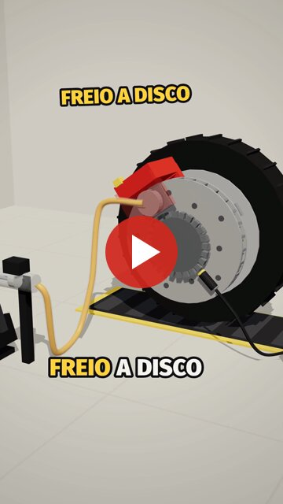

# ai-motion

Vídeos curtos explicativos (9:16, em português) feitos **inteiramente em código**. Cada quadro é desenhado de forma procedural num `<canvas>`, em 2D ou em 3D com three.js. A trilha e os efeitos sonoros são sintetizados. A narração usa uma voz clonada na Cartesia, e as legendas acendem palavra por palavra.

O fluxo usa a skill [`animate`](https://github.com/cth9191/animate) (licença MIT) para o Claude Code, com ajustes locais. As etapas são: roteiro → aprovação → look → storyboard → animação → exportação para MP4 → revisão automática.

## Vídeo publicado: o freio a disco

<a href="https://www.youtube.com/shorts/buo4B_V1nYg">
  
</a>

▶️ **[Assistir no YouTube](https://www.youtube.com/shorts/buo4B_V1nYg)**

> O GitHub não permite `<iframe>` em README. Por isso a capa acima é uma imagem que leva para o vídeo no YouTube.

O formato é uma montagem cumulativa: **problema → solução → "Esse é o X"**. O carro precisa parar, então entram em sequência:

- o disco;
- as pastilhas;
- o fluido;
- a pinça;
- o disco ventilado;
- o ABS.

Cada peça aparece em cena com o nome em amarelo. É um 3D low-poly renderizado com three.js, com sombras suaves, câmera animada e cortes secos no momento de pico (a roda travando).

## Peças

| Peça | Estilo | Duração | Pasta |
|---|---|---|---|
| **Freio a disco** | 3D low-poly (three.js r159), estilo próprio `lowpoly3d` | 55 s | [`pieces/freio-disco`](pieces/freio-disco) |
| **Mitose** | 2D recorte de papel (`cut-paper`) | ~28 s | [`pieces/mitose`](pieces/mitose) |

Cada pasta tem um `LOG.md` com as decisões, os problemas encontrados e o resultado da revisão.

## Estrutura

```
.claude/skills/animate/    skill animate (kit, estilos, ferramentas de build/export/review)
pieces/<nome>/
  piece.json               formato, estilo, voz e a lista de partes concatenadas no build
  src/                     cenas, render e trilha da peça
  styles/                  estilo próprio da peça (ex.: lowpoly3d)
  vendor/                  bibliotecas embutidas (three.min.js)
  voice/script.json        roteiro: uma fala por linha, com pausas
  voice.json               tempos de cada fala e palavra (gerado; usado nas legendas)
  storyboard.png | board.png
scripts/cartesia_voice.py  gera as falas com a voz clonada (Cartesia sonic-3.6)
docs/                      imagens do README
```

### Como uma peça 3D funciona

- `src/world.js` monta a cena three.js com primitivas simples: roda, disco, pinça, pedal, tubo de fluido, sensor ABS e carro.
  - O movimento (velocidade da roda, pedal, pulsos do ABS) é **pré-calculado a 120 Hz**. Isso deixa cada quadro determinístico.
- `src/scenes.js` posiciona as peças e a câmera em função do tempo. Os marcos de tempo (`CU.*`) vêm das palavras da narração. Assim, a animação acompanha a voz automaticamente.
- `src/render.js` faz o seguinte:
  - renderiza o 3D num canvas WebGL fora da tela;
  - copia o resultado para o canvas 2D;
  - desenha por cima os títulos e as legendas (Fira Sans Heavy).
- `src/score.js` sintetiza os efeitos sonoros: encaixes, chiado, ar, pneu cantando e o tique-tique do ABS. A música de fundo existe, mas está desligada (`MUSIC = false`).

## Requisitos

- Node 18+ e ffmpeg no PATH.
- `npm install`, que instala o Playwright e o three, e depois `npx playwright install chromium`.
- Python 3 com `pip install -r requirements.txt`, que traz `cartesia` e `faster-whisper`.
- Uma chave da Cartesia em `~/.config/clip-ai/ai-motion.env`, na linha `CARTESIA_API=...`. **Ela fica fora do repositório.**

No Linux com NVIDIA, a exportação 3D usa ANGLE `gl-egl`, e não Vulkan, porque o Vulkan quebrava os shaders do three.js. O ajuste está em `.claude/skills/animate/tools/gpu.mjs`.

## Como gerar um vídeo

O áudio e os vídeos **não estão no repositório**. Para refazer uma peça:

```bash
# 1. narração: uma take por fala, com a voz clonada
.venv/bin/python scripts/cartesia_voice.py pieces/freio-disco --emotion excited
#    (freio-disco: depois, acelerar cada take para 1.4x)
#    ffmpeg -i fala.wav -filter:a atempo=1.4 fala-1.4x.wav

# 2. junta as falas e calcula o tempo de cada palavra (legendas)
PATH=$PWD/.venv/bin:$PATH VO_LANG=pt node .claude/skills/animate/tools/voice.mjs pieces/freio-disco --model small

# 3. build → pieces/<nome>/index.html (abre no navegador para pré-visualizar)
node .claude/skills/animate/tools/build.mjs pieces/freio-disco

# 4. exporta → renders/final.mp4 e renders/share.mp4
node .claude/skills/animate/tools/export.mjs pieces/freio-disco --share

# 5. revisão automática (legendas na área segura, cortes, volume, ritmo...)
node .claude/skills/animate/tools/review.mjs pieces/freio-disco
```

## Preferências de produção

- Formato vertical 9:16 e legendas palavra por palavra **sempre**.
- Narração em 1.4x, acelerada com `atempo` do ffmpeg, porque a velocidade da Cartesia quase não muda essa voz.
- Por enquanto, sem música de fundo: só efeitos sonoros, com impactos de conclusão suaves.
- As referências de formato, como o canal *Desmontando o Mundo*, servem só como inspiração de formato e visual. O roteiro e os modelos 3D são originais.
